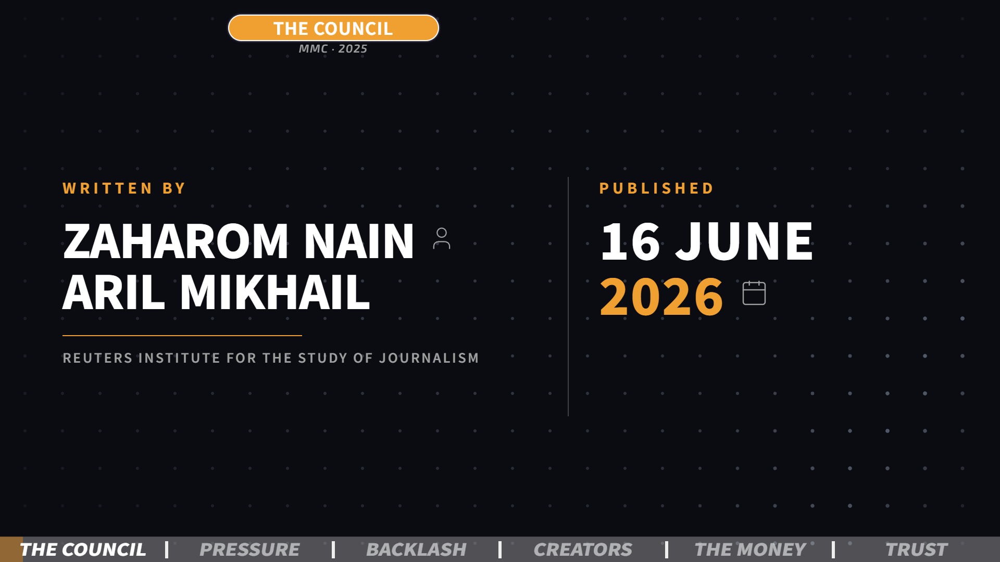
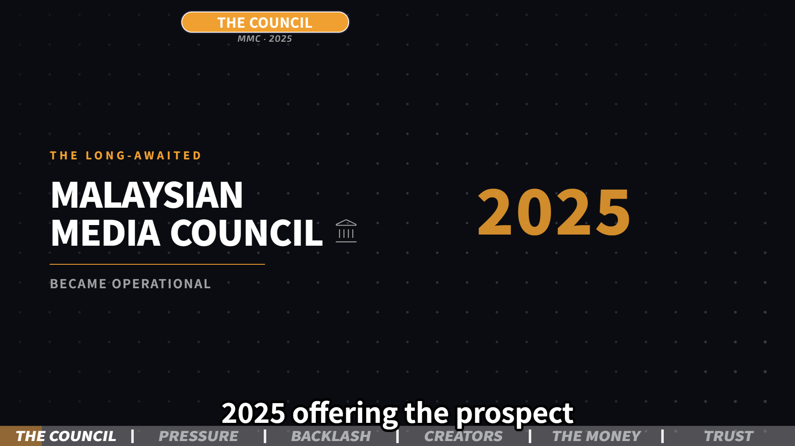
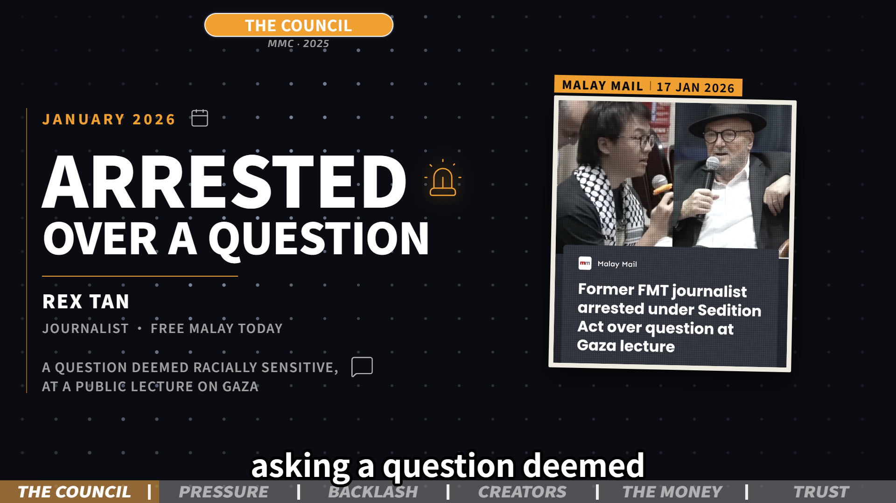
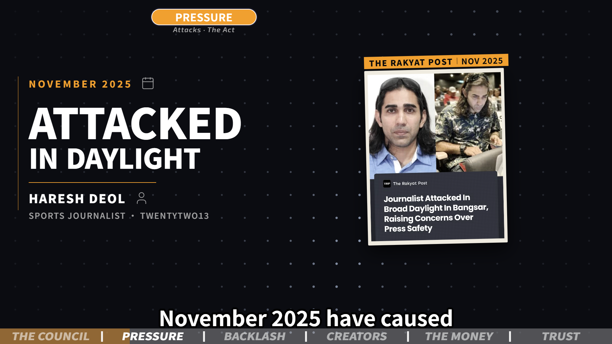
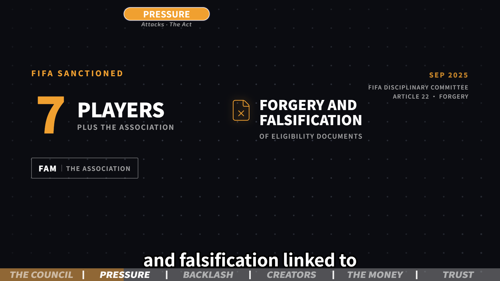
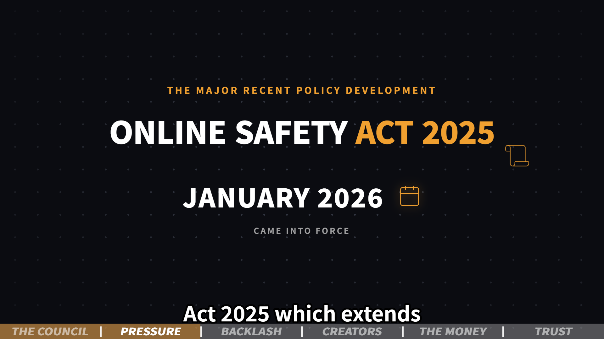
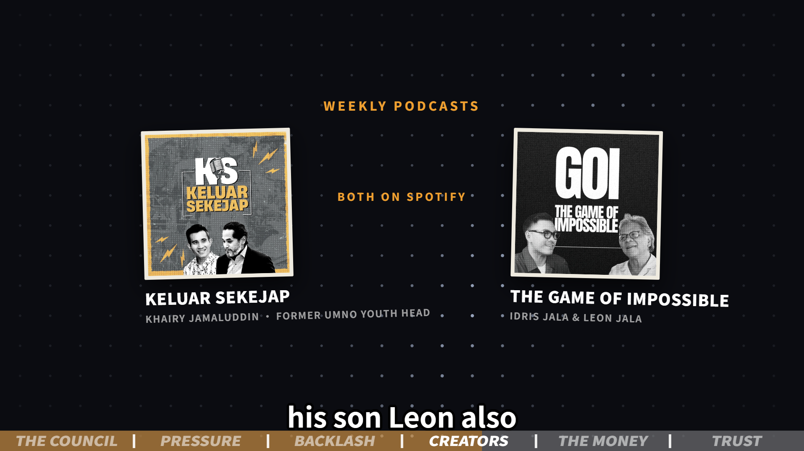
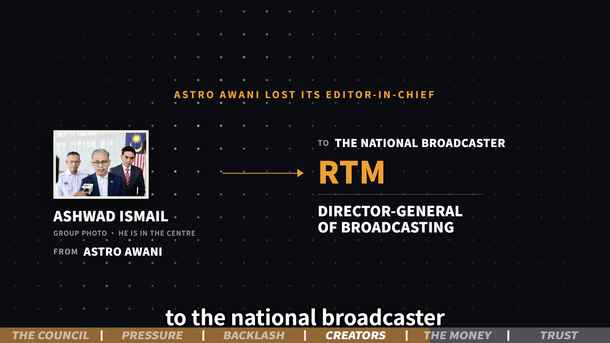

# 数据新闻解释视频 · 模板工程

把一份研究报告做成 5 分半的横版解释视频。**这条片子本身是模板**——所有镜头代码、图元、脚本、时间轴都在仓库里，换一份报告就能重做一条。

基于两个上游项目，本仓库只做「怎么用它们做一条完整片子」的实践沉淀：

- **[anything2explainer](https://github.com/Vincentwei1021/anything2explainer)** — Remotion 模板、镜头语言体系、图元层
- **[shotcraft](https://github.com/Vincentwei1021/shotcraft)** — 分镜方法论、镜头模式表

---

## 这条片子在讲什么

路透社新闻研究所《2026 数字新闻报告》马来西亚篇：一个刚成立的媒体理事会，如何在一年内被现实反复打脸。

| 章节 | 时间 | 内容 |
|---|---|---|
| THE COUNCIL | 0:00 | 媒体理事会成立，法案到机构的落地 |
| PRESSURE | 2:11 | 记者遇袭、罚款、网络安全法生效 |
| BACKLASH | 4:01 | 三家组织联合声明、当今大马的资金挪用 |
| CREATORS | 6:01 | 32% 的人从网红获取新闻 |
| THE MONEY | 7:57 | 股权、广告下滑、AI 裁员 |
| TRUST | 10:29 | 信任度从 41% 跌到 30% |

全片 53 个镜头，217 条词级字幕，六个章节卡。

## 画面参考

八种镜头语言，全部由代码绘制。真图只出现在证据卡里（新闻截图、播客封面、人物头像），其余都是排版、数字与图标。

<table>
<tr>
<td width="50%"></td>
<td width="50%"></td>
</tr>
<tr>
<td><sub><b>署名</b>　C01 · 压印字 + 图标 cue</sub></td>
<td><sub><b>大数字</b>　C02b · 2005 用 FONT_HEAVY，非 Orbitron</sub></td>
</tr>
<tr>
<td></td>
<td></td>
</tr>
<tr>
<td><sub><b>证据卡</b>　C06b · 压印大字 + 截图卡片 + 出处 tab</sub></td>
<td><sub><b>左文右图</b>　C07 · 栏线 + 衬线排版感</sub></td>
</tr>
<tr>
<td></td>
<td></td>
</tr>
<tr>
<td><sub><b>量级</b>　C08b · 大数字 + 描边框 + 归类标签</sub></td>
<td><sub><b>法案名</b>　C11a · 四词并列 + 日期行</sub></td>
</tr>
<tr>
<td></td>
<td></td>
</tr>
<tr>
<td><sub><b>双图并置</b>　C18a · 两张封面同族处理（纸边 + 网点）</sub></td>
<td><sub><b>流程</b>　C20b · 人事流动，箭头 draw-on</sub></td>
</tr>
</table>

---

## 目录

```
.
├── remotion/                  Remotion 工程
│   ├── src/
│   │   ├── common/            配色、字体、时间轴（由 script 生成）
│   │   ├── figures/           图元：证据卡、压印字、图标 cue
│   │   ├── icons/             48 个题材图标（Lucide，ISC）
│   │   ├── overlay/           章节卡、进度条、片尾署名
│   │   └── shots/G1/          ★ 53 个镜头，按章节分文件
│   ├── public/fonts/          Noto Sans SC / Exo 2 / Audiowide / Orbitron
│   └── package.json
├── script/
│   ├── locked_script.md       权威文案（画面文字以此为准）
│   ├── termbase.md            术语表（人名、机构名的固定译法）
│   ├── build_timeline.py      词级对齐 → timeline.ts / subs.ts
│   ├── words.json             逐词起止（由 TTS 对齐产出）
│   └── narration-phrase.*.srt 中英文跟读字幕
├── docs/
│   ├── evidence-checklist.md  证据红线清单（哪些数字能上屏）
│   ├── narration-full.md      完整旁白
│   └── project-log.md         这条片子的工程日志（562 行，含全部踩坑）
├── _tools/
│   ├── verify_sources.mjs     核对画面数字与原文出处
│   ├── fetch_og.mjs           抓取新闻页 OG 图
│   └── grab_avatar.mjs        抓取人物头像
└── assets/sources.json        ★ 证据出处总表：机构 + 日期 + URL + 红线
```

**不含**：新闻截图、人物照片、播客封面、背景音乐、成片。这些都有第三方版权，见下文「素材与版权」。

---

## 上手：做一条新片子

### 0 前置

```bash
git clone https://github.com/Vincentwei1021/anything2explainer ../_ref_anything2explainer
cd remotion && npm install
```

Node ≥ 20.19（Vite 7 的要求）。Remotion 首次渲染会下载 Chrome Headless Shell。

### 0.5 找资料与取证（先做这一步）

**原则：屏幕上出现的每一个数字、人名、日期，都要能点回一个页面。** 做不到就不上屏，也不念。

**一 定位原始报告。** 先锁定一手来源，不要从二手转述开始。本片是路透社新闻研究所《2026 数字新闻报告》的马来西亚国别页，正文十段、两位作者、2026 年 6 月 16 日发布。抓取时先取 HTML 再解析 `p` 标签，避免被摘要工具截断——我第一遍用通用抓取只拿到前六段，差点漏掉后面关于网红、广告下滑和 AI 裁员的三段。原文页整页长图用 Playwright 截下来存在 `docs/page/`，配 `targets.json` 记坐标。

**二 一个事实一条出处。** 报告里的每一句判断，都要找到更细的落地来源：记者遇袭去查当事媒体和警方通报，机构成立去查官方新闻稿，广告数据去查行业机构原文。本片最终落了 **27 条事实、34 条出处**，全部写进 `assets/sources.json`：

```json
{ "kicker": "MALAY MAIL", "dateLabel": "MALAY MAIL · JAN 2026",
  "headline": "...", "sources": [{"org": "...", "date": "...", "url": "..."}],
  "media": [...], "redline": "这里的 796 实际是 7.96%，ASR 把小数点拆掉了" }
```

`redline` 这一栏是给未来的自己看的：写清这条为什么容易被误读。

**三 机器核验，不靠眼睛。** 出处写完必须跑一遍：

```bash
node _tools/verify_sources.mjs
```

它会用系统 Edge 逐条打开 34 个 URL，打印页面标题、h1 和页内可见日期，用来核对「机构 + 日期」是否与 `sources.json` 写的一致。本片 34 条里 33 条通过，ARTICLE 19 那条因 Cloudflare 对 headless 返回 403——URL 本身有效，搜索结果可佐证，这种情况要单独记下来而不是悄悄放过。

**四 抓图一律走真浏览器。** Wikipedia、Wikimedia、YouTube、Iconify 在 curl 或无头请求下多半被挡：

```bash
node _tools/fetch_og.mjs assets/news https://example.com/article   # 抓 og:image
node _tools/grab_avatar.mjs assets/portrait <url>                  # 抓头像
```

两个脚本都走 `playwright-core` + 系统 Edge，别改成 fetch/curl，会被 403 挡回来。群像素材必须记录谁是谁，这是事实问题，不是礼貌问题。

**五 缺口要有决策记录。** 补不上的素材，写清为什么不补。本片的记录在 `docs/project-log.md`「素材清单与缺口决策」：播客封面抓不到 → 改人物卡加节目名；机构 logo 分辨率太低 → 改文字报头式排版。**取证文档比截图重要**，截图只是可选项。

### 0.6 搜索资料的方法论

这一步此前踩过坑，把可复用的做法写下来。

**搜索词一律英文，按"事件 + 主体 + 关键数字"组。** 中文报道往往转述失真，英文一手源更接近原始通报。遇到表述不清的票据，先把它拆成几个可搜的英文关键词分别验证，不要拿模糊中文描述直接搜。

| 模糊表述 | 拆出的英文搜索词 | 命中 |
|---|---|---|
| 嫌疑人认罪罚款 | 记者姓名 + `assault suspect pleaded guilty fined` + 金额 | 当事媒体与警方通报 |
| 三组织联合声明 | 组织全名 + `joint statement` + 法案名 | 组织官网原始声明 |
| 机构成立 | 法案名 + `act passed` + `council established` + 月份 | 官方新闻稿 |

**先逐字比对再下结论。** 判断"音频跳了一句"或"图上有错"之前，先做词级逐字对照；判断缩略图缺陷之前，先量像素，别凭小图观感。本片 831 词逐段与有声稿一致，9 处所谓"差异"全是标点被对齐器吃掉（连字符词、小数点），不是真实差异。

**一手源优先级的实践经验：**

- 事件发生 → 当事媒体原文、警方通报、官方新闻稿，不用聚合站转述
- 政策法案 → 政府或立法机构原文，不用评论文章
- 组织表态 → 组织官网原始声明，不用媒体报道里的引述
- 数字数据 → 发布方原始报告，不用二手引用

**同一事件多源时，配图来源和权威来源分开记。** 本片 C15 的图片来自某财经媒体，权威 URL 另有其站；两条都进 `sources.json`，但念白的数字以一手源为准。只有一条能直接用画面，另一条作交叉印证，不做"双源上屏"。

**网络抓取的现实约束**（本机环境，换机器要重新验证）：

- Wikipedia / Wikimedia / Iconify 的直接请求多被挡，抓素材一律走 `playwright-core` + 系统浏览器
- 在线 Demo 类服务常有免费额度限制，全片级任务可能超限；批量任务优先本地模型
- 模型下载走可达的镜像源；被代理拦的源不要反复重试，直接换源
- 在线服务的 token 只能写进被 `.gitignore` 屏蔽的文件，README 与提交物里一律写掩码形式如 `ms-****`，交接前吊销重发

### 0.7 新闻图片的整理方法

**图片来源分三类，分开记账。** 用户手动准备的新闻截图、自动抓取的头像与 logo、从原文页截的全页长图，三者的授权和用法不同，不要混在一个目录里不做区分。本片的落地结构是顶层放新闻截图，`assets/portrait/` 放人物，`assets/logo/` 放机构与平台标识，`docs/page/` 放原文长图与坐标 JSON。

**文件名前缀就是来源。** 用户给的新闻图用"新闻源_事件描述"命名，前缀即出处，便于回溯和核对。自动抓取的用人物英文 slug 或机构名，统一小写连字符。不要改用户素材的文件名——后续脚本和清单可能按名字精确匹配。

**每张图入画前做三判定：**

| 判定 | 做法 | 不通过的后果 |
|---|---|---|
| 是不是本人 | 逐张看图核对，群像要写清谁在中间 | 误认就是事实错误，不是礼貌问题 |
| 念白有没有这个数字 | 截图自带但念白没说的数字必须裁掉或遮掉 | 画面出现念白外的数字，违反数字纪律 |
| 分辨率与用法匹配 | 按"显示尺寸不超过源图宽"判断，别放大 | 放大糊边 |

**分辨率问题的正解是改用法，不是换图。** 本片新闻截图最高约 1600px，达不到全屏缓推的门槛；一度以为素材不可用，后来把证据从"真图全屏缓推"改成"画面里的证据块"，缩到 320 到 520px 显示，所有源图都是缩小使用，分辨率缺口自然消失。**先想清楚图在画面里扮演什么角色，再判断清晰度够不够。**

**不是每个拍子都要图。** 机构姿态的总括、引语这类拍子，现实中本就没有对应新闻图片，强行配图会和相邻的唯一证据卡撞车，反而分散注意力。一张证据卡的分量来自它是这一段的唯一一张。相邻拍子构图要相反（居中 ↔ 左文右图 ↔ 左对齐引语），这是"相邻 beat 首尾语言不同"的落地方式。

**入画前先裁。** 去掉平台台标和原图的渐变边，裁成合适比例，再放进工程素材目录，文件名用段号前缀。保留原始图不动，裁切件作为派生文件。

**抓不到就记理由，不硬凑。** 本片播客封面抓取超时且低质，改成人物卡加节目名加平台标识；机构 logo 分辨率太低，改成文字报头式排版。取证文档里的"缺口与决策"比截图本身更重要——它记录的是判断，不是遗憾。

**用户明确排除的素材不要入片。** 本片有一张社媒信息图，数字全是念白外的，用户决定不用，文档里记一笔"不入片"即可，不要因为它话题相关就塞进去。

### 0.8 证据管理的下一步（未实现，方向记录）

现在这套是「截图 + `sources.json` 双轨」，但主从关系是反的：**截图是派生物，URL 才是主键。**

**为什么只有 5 处真图，不是 53 处。** 全片 53 镜里新闻截图只用了 5 个（Deol 遇袭、Rex Tan 被捕、FIFA 制裁、三组织声明、RM3m 挪用），其余 48 镜是无图拍子。这不是素材不够——是证据卡的分量来自"这一段的唯一一张"，每拍都上图会退化成缩略图轮播。而片子里最有冲击力的几个数字（信任度 41%→30%、裁员 44%、广告 -22%/-9.5%/-39%）本来就没有对应新闻截图，它们来自报告表格。

**方向一：URL 作主键。** 取证时只记可访问 URL，由 AI 读封面图与正文，产出结构化记录（机构、日期、标题、关键数字、与念白的对应关系）。好处是图丢了能重抓、事实核对从"人眼看图"变成"机器比对 + 人审判断"、仓库里不存版权副本。代价是依赖联网，且社媒卡、付费墙、图片型排版仍要人工。

**方向二：文件放大标注。** 本片没有这个视觉语言——需要「截图 → 推近 → 框选关键词 → 引线标注」的组合，上游两个项目都只有零件、没有成品：

| 项目 | 提供的零件 |
|---|---|
| [shotcraft · document-typewriter-reveal](https://github.com/Vincentwei1021/video-shotcraft/blob/main/references/shots/typography/document-typewriter-reveal.md) | 文档窗口 + 相机后撤 + 关键词长底色高亮 |
| [shotcraft · marker-underline-title](https://github.com/Vincentwei1021/video-shotcraft/blob/main/references/shots/typography/marker-underline-title.md) | 马克笔一笔下划线 |
| [anything2explainer](https://github.com/Vincentwei1021/anything2explainer) `template/src/fx.tsx` | `CameraRig` / `camAt` 运镜系统 |
| [template-code-hike](https://github.com/remotion-dev/template-code-hike) | 代码逐行高亮（结构化输入，不适用于图片） |

前置条件：素材 ≥ 2400px。现在 1600px 的截图放大两倍就糊了，所以真要往这个方向走，取证环节得先用 2x 截图。

### 1 写文案

`script/locked_script.md` 是全片的唯一文案源。**画面上的每一个字都从这里来**，包括章节标题、卡片标签、结论行。

写法上有两条约束：

- **一句话一个意思。** 旁白是给耳朵的，画面文字是给眼睛的，两者不必逐字相同，但事实必须同源。
- **数字只写念白里出现过的。** 念白说 `3 million ringgit`，画面就写 `RM 3 MILLION`，不要自己补美元换算；念白说 `sanctioned for forgery`，就不要把罚款金额上屏。

`script/termbase.md` 锁定人名与机构名的写法，避免同一个 `Khairy Jamaluddin` 在片中三种拼法。

### 2 配音（Qwen3-TTS 魔搭 Demo）

旁白用 **Qwen3-TTS**，跑在魔搭的在线创空间，不用本地装环境、不占显存：

👉 https://modelscope.cn/studios/Qwen/Qwen3-TTS

**怎么找到这类 Demo。** 三条路，按可靠度排：一是从模型页跳，ModelScope 上搜模型名（`Qwen3-TTS`），详情页右上角有「创空间 / 在线体验」入口；二是直接进创空间广场按任务类型筛（语音合成 / 语音克隆）；三是认准它是 Gradio 应用——任何创空间页面只要 `GET /config` 能返回 JSON、`GET /gradio_api/info` 能列出 `named_endpoints`，就能按下面 2.2 的方式用接口调，不必点网页。换一个空间只改域名：`studio-<空间名>.api-inference.modelscope.net`（空间名全小写、连字符），先验 `GET /config` 有 body，再读 `/gradio_api/info` 拿参数表，协议完全一致。

**本片用的不是预设音色，是克隆音色。** 手里有一段目标声音的 10 秒样本，同页「Voice Clone」用它做参考，把该段样本的原文填进 `ref_text`，模型就会按这个音色和语流念新稿子。预设音色（`Ryan` / `Aiden` 英文男声，`Vivian` / `Serena` / `Uncle_Fu` 中文）只是备选，音色是"通用男声"，接不上已有片子的风格。

两条路都能走，**推荐走接口**：网页点一次两分钟，27 段就是一下午，而且参数没法固定。

#### 2.1 网页路径（偶尔跑一两句时用）

打开上面的链接，切到 Voice Clone 页签，上传参考音频、填参考原文、填要念的文本，语言选 English，模型选 1.7B，点生成，下载 wav。适合试音色，不适合批量。

#### 2.2 接口路径（批量合成，本片就是这么做的）

这个创空间是 Gradio 6.2.0 应用，匿名能读接口清单，但上传和调用要登录。网页登录态没法在脚本里复用，正确做法是申请**个人访问令牌**：

```
https://modelscope.cn/my/access/token  →  形如 ms-****************
```

令牌放在环境变量里，**不要写进任何入库文件**：

```bash
export MS_TOKEN='ms-****************'
```

`.gitignore` 已屏蔽 `.env` 与 `token.txt`。令牌可随时在同一个页面吊销重发，交接之前先吊销。

> **注意：域名只认这一个，写错会得到假的成功。**
>
> ```
> https://studio-qwen-qwen3-tts.api-inference.modelscope.net
> ```
>
> 少了 `studio-` 前缀（`qwen-qwen3-tts.api-inference...`）会返回 **200 但 body 为空**——不是报错，是 WAF 兜出来的假成功，最难查。往 `qwen-qwen3-tts.ms.show` 发令牌则必定 403（那个域名只认 cookie）。网上教程里的 `www.modelscope.cn/api/v1/studio/.../gradio/` 已经 404。

调用是四步，全部是普通 HTTP，不依赖 `gradio_client`：

```bash
API=https://studio-qwen-qwen3-tts.api-inference.modelscope.net

# ① 上传参考音频，字段名必须是 files
curl -s -H "Authorization: Bearer $MS_TOKEN" \
  -F "files=@ref-10s-24k-mono.wav" \
  "$API/gradio_api/upload?upload_id=$(date +%s)"
# → ["/tmp/gradio/<hash>/ref-10s-24k-mono.wav"]

# ② 提交任务
curl -s -H "Authorization: Bearer $MS_TOKEN" -H "Content-Type: application/json" \
  -d '{"data":[{"path":"<上一步的路径>","meta":{"_type":"gradio.FileData"}},
               "<参考音频的原文>","<要念的文本>","English",false,"1.7B"]}' \
  "$API/gradio_api/call/generate_voice_clone"
# → {"event_id":"..."}

# ③ 取结果（SSE 流，中间夹杂若干 heartbeat）
curl -sN -H "Authorization: Bearer $MS_TOKEN" \
  "$API/gradio_api/call/generate_voice_clone/<event_id>"
```

**两个必踩的坑：**

- **结果藏在最后一条数据里。** 克隆接口会先吐一串 `null`，真正的音频在后面某一条 `data:` 里，形如 `[{"url":...}, "Voice clone generation completed successfully!"]`。按第一项取永远是 `None`，必须遍历所有 `data` 找带 `url` 的那条。
- **下载音频不能带令牌。** 返回的 `url` 指向 `ms.show` 域名，带 `Authorization` 会 403，去掉头直接下载即可。

#### 2.3 两条硬限制

**一、单次生成约 20 秒封顶。** 实测：

| 目标词数 | 音频时长 | 结果 |
|---|---|---|
| 18 | 7.67 s | 成功 |
| 39 | 17.09 s | 成功 |
| 50 | 19.17 s | 成功 |
| 68 | 约 27 s | **失败** |

12.5 帧/秒换算，上限约 256 帧 = 20.5 秒。超了不报错，是等三四分钟后返回全 `null`，白跑。所以**切分预算取 48 词/段**，实测落在 15 到 19 秒。本片 831 词切成 **27 段**，最长 19.89 秒。

**二、参考音频必须和 `ref_text` 严格配套。** 拿 32.8 秒的音频配 11 秒的文本，必报 `data: null`；换成 11 秒音频配 11 秒原文，一次通过。ICL 是文本 token 对音频 codec 帧，长度差几倍就崩。参考音频规格：24 kHz 单声道 WAV，8 到 12 秒最稳。

```bash
ffmpeg -i sample.mp3 -ar 24000 -ac 1 ref.wav
```

#### 2.4 分段与拼接

**分段合成，不要一次喂全文。** 除了上面那条 20 秒硬限制，还有四个理由：

- 长文本语气会漂移（开头严肃、三分钟后变平）
- 某一句读错，只重跑那一句，不用重跑五分半
- 每段时长可控，方便对齐章节边界
- 段落文件是后续逐词对齐的输入单位

切分只断在句号上，永不切句子；同一段内的句子优先留在一组。拼接时段间留白分级：同段换块 0.30 s，换段 0.65 s——后者就是后来切章节边界的依据（见 2.5）。

```bash
# 拼接（files.txt 每行一个 wav）
ffmpeg -f concat -safe 0 -i files.txt -c copy joined.wav
# 转工程格式
ffmpeg -i joined.wav -ar 48000 -ac 2 audio.mp3
```

本片成品 332.927 秒，交付版做 EBU R128 归一到 −16 LUFS。

> 本地部署备选：`pip install qwen3-tts`，然后 `qwen-tts-demo Qwen/Qwen3-TTS-12Hz-1.7B-CustomVoice --port 8000`。1.7B 需 6–8GB 显存，0.6B 需 4–6GB。注意本地版没有 `ref_text` 参数，克隆只能还原音色、还原不了语流，做不到线上 Demo 的 ICL 效果。

### 2.5 逐词对齐与时间轴

时间轴精度决定字幕和图标 cue 的精度。对齐方案：

| 方案 | 说明 |
|---|---|
| **Qwen3-ForcedAligner** | Qwen3-ASR 配套，词/短语级时间戳，11 种语言，精度优于 MFA/CTC |
| WhisperX / faster-whisper | 生态成熟，中文需额外分词处理 |
| FireRedASR2-CTC int8 | 纯 CPU 可跑，中英混排字级偏差 20–40 ms |

对齐产物转成 `words.json`，格式：

```json
[{"w": "Malaysia's", "s": 0.0, "e": 1.52, "cid": "C01"}]
```

`cid` 是镜头编号，词级图标 cue 靠它定位。然后：

```bash
python script/build_timeline.py
```

生成 `remotion/src/common/timeline.ts`（章节边界、镜头区间）和 `subs.ts`（字幕）。

**改了文案或章节表才需要重跑这一步。**

### 3 写镜头

一个镜头一个文件，放在 `remotion/src/shots/G1/`：

```tsx
export const C07: React.FC = () => {
  const frame = useCurrentFrame();
  const N = frame + F0;        // F0 = 本镜头起始帧
  const n = N - F0;            // 相对帧，所有动画都用它
  // ...
};
```

在 `shots/G1/index.ts` 注册：

```ts
{id: 'G1-C07', from: 2004, to: 2233, Comp: C07}
```

**区间必须首尾相接**：上一个 `to` 加一等于下一个 `from`。

写的时候看 `docs/project-log.md`——里面按章节记了每个镜头为什么这么构图、踩了什么坑。

### 4 渲染与合成

```bash
# 抽帧检查（改完必做）
npx remotion still src/index.ts Video ../qa/frame.png --frame=2140

# 分章渲染（每章一个文件，出错只重跑一章）
npx remotion render src/index.ts Video ../renders/ch3.mp4 \
  --frames=3949-5452 --codec=h264 --crf=16

# 合并
ffmpeg -f concat -safe 0 -i list.txt -c copy full.mp4
```

**合并后必须核对帧数**：

```bash
ffprobe -v error -select_streams v:0 -show_entries stream=nb_frames -of csv=p=0 full.mp4
# 必须等于 timeline.ts 里的 TOTAL_FRAMES
```

不等就是镜头区间有重叠或空档，tsc 查不出来。

### 4.5 垫乐选择

垫乐是这条片子最容易被忽视、也最容易翻车的一环。选定前先过五道筛子：

| 筛子 | 标准 | 为什么 |
|---|---|---|
| **长度** | ≥ 片长，一遍覆盖 | 不够就得循环，接缝处必然有断点 |
| **无人声** | 纯器乐 | 有人声采样会和旁白抢注意力 |
| **无强旋律** | 织体为主，旋律线弱 | 强旋律会被记住，反复听就烦 |
| **动态范围** | LRA 5–7 | 太低（<3）闷成一片，太高（>10）忽大忽小 |
| **频段留白** | 200–800Hz 不厚 | 这是人声区，占住了就糊字 |

本片用的是 **PaperClip（回形针）《GOOD SHOW》**（339.07s / 44.1kHz / 24bit / 立体声）：

- 长度 339.07s 对片子 337.19s，**一遍够用，零循环、零接缝**
- LRA 6.00，段落起伏明显（开头弱 4.6 dB → 主体 → 结尾收）
- 本身 Side/Mid 仅 −15.6 dB，立体声宽度够，不需要大改

素材到手先跑三条命令，比听十遍更准：

```bash
# 1 长度与格式
ffprobe -v error -show_entries format=duration -show_entries stream=sample_rate,channels -of default=noprint_wrappers=1 bed.flac

# 2 响度与动态（看 input_lra）
ffmpeg -hide_banner -i bed.flac -af "loudnorm=I=-16:print_format=json" -f null - 2>&1 | grep -A5 input_i

# 3 内部静音断点（若有多段静音，说明是分段作品，循环点要选在乐段结束处）
ffmpeg -hide_banner -i bed.flac -af "silencedetect=noise=-50dB:d=1" -f null - 2>&1 | grep silence
```

选好之后进混音，见下节。

### 5 混音

三条轨：旁白、垫乐、总限幅。目标是旁白 −16 LUFS，垫乐比旁白低 **12 dB**（这是验证过"念白清晰且不单调"的比例）。

```bash
ffmpeg -i bed.wav -i voice.mp3 -filter_complex "
  [0:a]aresample=48000,extrastereo=m=1.4,
       equalizer=f=95:g=2.4,equalizer=f=210:g=-1.6,
       volume=-6.4dB[bed];
  [bed][1:a]sidechaincompress=threshold=0.07:ratio=2.4:attack=15:release=380[ducked];
  [ducked][1:a]amix=inputs=2:normalize=0,loudnorm=I=-16:TP=-1.5[out]
" -map "[out]" -ar 48000 mix.flac
```

四处参数的理由：

- `extrastereo=m=1.4` — 垫乐加宽。M/S 矩阵处理，不引入延迟，低频不会相位抵消（**不要用 `stereowiden` 的 delay 做这件事**，它会毁掉低频）
- `equalizer 95Hz +2.4` — 混音后旁白占据中高频，低频会显得薄，补一点超低频细节
- `equalizer 210Hz −1.6` — 给旁白基频（85–180Hz）让位
- `sidechaincompress` — 人声密集处垫乐退让。`attack 15ms` 跟得上起音，`release 380ms` 保证句间短停顿不会让音乐忽上忽下

**验证混音是否合格**，看三个数：

```bash
# 响度与真峰值
ffmpeg -hide_banner -i mix.flac -af "loudnorm=I=-16:TP=-1:print_format=json" -f null - 2>&1 | grep -A4 input_i
# 目标：I ≈ -16，TP ≤ -1

# 削波
ffmpeg -hide_banner -i mix.flac -af volumedetect -f null - 2>&1 | grep max_volume
# 目标：max ≤ -1，且 histogram_0db 为 0

# 分段相对差（旁白 vs 垫乐，抽查 5 处）
# 目标：全片 8–14 dB 之间，任何一段都不低于 6 dB
```

分段相对差是这条片子唯一的硬伤来源。如果某一段旁白本身录得轻（本片 3:50 处就低 4–5 dB），而垫乐保持恒定，那一段会突然"音乐变大"——此时单纯靠闪避补不回来，需要整体降垫乐电平。

替换进视频：

```bash
ffmpeg -i full.mp4 -i mix.flac -map 0:v -map 1:a \
  -c:v copy -c:a aac -b:a 320k -movflags +faststart final.mp4
```

`-c:v copy` 保证画质零损失。

---

## 七条不能违反的约定

都是踩出来的，`docs/project-log.md` 有完整案例。

**一 镜头区间首尾相接，末帧硬切。**
不要淡入淡出。每拍末尾 `const exit = 1`，直接接下一拍。淡出会让连续片看起来被拉慢。

**二 图标必须行内对齐。**
用 `flex + align-items: center + gap`，不要手算绝对坐标。字宽估算永远差几十像素。

**三 画面上的数字用 `FONT_HEAVY`，不用 Orbitron。**
Orbitron 与 Audiowide 的 `0` 是斜杠零（`2026` 读作 `2Ø26`），`7` 是直角下垂（孤立时像 `⌐`）。

**四 章节卡必须挂在镜头上层。**
a2e 默认把它放在最低层（原设计里章节卡占章前空白）。本片章节卡覆盖在章首镜头上，放低层会被镜头整个盖住。

**五 `Box`、`Icon`、非 inline 的 `IconCue` 都是绝对定位。**
塞进 `position: absolute` 的 flex 容器，偏移会叠加两次。并排盒子用普通 `div`。

**六 念白外的数字不上屏。**
包括：报告里有但旁白没读的、你自己算出来的（如"七年"）、新闻截图上的（裁掉）。

**七 群像素材必须标注谁是谁。**
`GROUP PHOTO · HE IS IN THE CENTRE`。这不是礼貌问题，不标注就构成误认。

---

## 素材与版权

**仓库不含任何第三方图片与音频。** 复用时你需要自己准备：

| 类型 | 来源建议 | 注意 |
|---|---|---|
| 新闻截图 | 原文页面自行截取 | 标注机构与日期，`assets/sources.json` 有格式 |
| 人物头像 | 官方新闻稿 / 维基百科 | 群像必须标注 |
| 播客封面 | 节目官方发布页 | 属于节目方，非你所有 |
| 背景音乐 | 授权曲库 | 本片用的是 PaperClip 的《GOOD SHOW》 |

`assets/sources.json` 是证据出处总表，每条记录包含机构、日期、URL 和事实红线（例如"这里的 796 实际是 7.96%，ASR 拆错了"）。**这份文件比图片重要**——它决定了画面上的每个数字能否站得住。

字体（`remotion/public/fonts/`）均为 SIL Open Font License 1.1，可随仓库分发。

图标来自 [Lucide](https://lucide.dev)（ISC License），见 `tools/LUCIDE_LICENSE.txt`。

---

## 许可证

本仓库的**镜头代码、脚本、文档**采用 [PolyForm Noncommercial 1.0.0](https://polyformproject.org/licenses/noncommercial/1.0.0)：

> **Required Notice:** Copyright (c) 2026 Vincent Wei (https://github.com/Vincentwei1021/anything2explainer)

因为核心框架来自 anything2explainer，其许可证要求：

- 非商业使用免费，**商业使用需原作者授权**
- 分发时必须保留上述 Required Notice
- 用这套工具做出来的**视频归创作者所有**（不受此限制）

如果你要在商业项目里用，先去 [anything2explainer](https://github.com/Vincentwei1021/anything2explainer) 找作者拿授权。

本片成片（YouTube 上那条）的版权归制作方，与本仓库的代码许可无关。

---

## 致谢

- **Vincent Wei** — [anything2explainer](https://github.com/Vincentwei1021/anything2explainer)、[shotcraft](https://github.com/Vincentwei1021/shotcraft)。镜头语言体系、图元层、分镜方法论都来自这两个项目，本仓库只是把它们用在了具体题材上。
- **Reuters Institute for the Study of Journalism** — 报告原文与数据。
- **Zaharom Nain、Aril Mikhail** — 报告作者。
- **PaperClip（回形针）** — 背景音乐《GOOD SHOW》。
